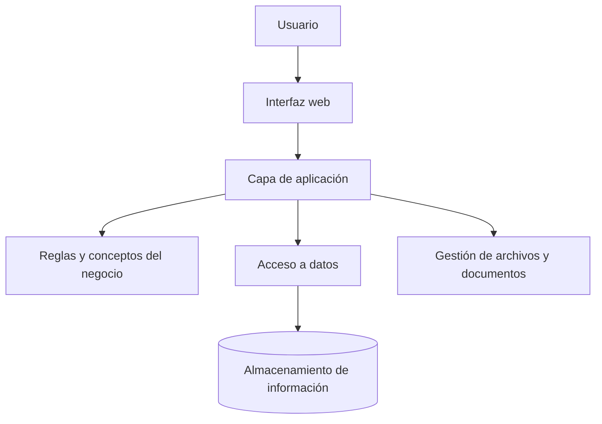

# Arquitectura inicial — Kubo PH

**Estado:** Borrador  
**Propósito:** Establecer principios para organizar la solución y orientar las decisiones técnicas posteriores.

## 1. Objetivo

Kubo PH se construirá como una plataforma web para apoyar la gestión de copropiedades. La arquitectura deberá permitir que el producto crezca por módulos sin perder organización ni flexibilidad.

## 2. Principios de arquitectura

- **Modularidad:** organizar las funcionalidades por áreas del negocio.
- **Separación de responsabilidades:** distinguir la interfaz, las reglas del negocio y el acceso a los datos.
- **Escalabilidad:** permitir incorporar nuevas funcionalidades y atender más copropiedades.
- **Mantenibilidad:** mantener una estructura comprensible y fácil de modificar.
- **Flexibilidad:** permitir cambios en reglas y plantillas sin tener que rehacer toda la aplicación.
- **Seguridad y privacidad:** definir controles de acceso y protección de la información antes de manejar datos reales.

## 3. Organización lógica propuesta

El diagrama representa una separación conceptual de responsabilidades. No define todavía tecnologías, servicios ni despliegue.

## 4. Módulos funcionales previstos

Los módulos se presentan como áreas iniciales de organización, no como una lista definitiva del MVP.

- Copropiedades
- Personas e inmuebles
- Cartera y pagos
- Documentos y plantillas
- Comunicaciones administrativas

Podrán agregarse, dividirse o ajustarse cuando se defina el alcance completo del MVP.

## 5. Decisiones técnicas pendientes

- Tecnologías de interfaz y servidor.
- Tipo y tecnología de base de datos.
- Autenticación, roles y permisos.
- Almacenamiento y manejo de archivos.
- Estrategia de pruebas.
- Despliegue, respaldos y monitoreo.
- Separación de información entre copropiedades.

## 6. Estado de la arquitectura

Esta propuesta es una base para conversar y documentar decisiones. No debe interpretarse como una arquitectura técnica aprobada ni como una instrucción para implementar todavía.
