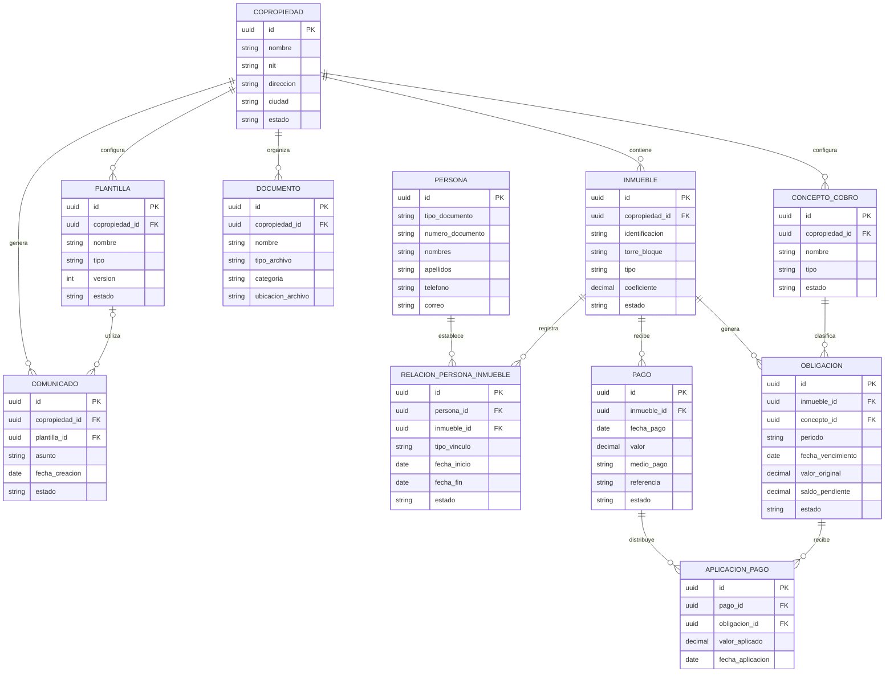

# Modelo lógico de datos — Kubo PH

**Versión:** 0.1  
**Estado:** Borrador inicial  
**Nivel:** Modelo lógico  
**Propósito:** Definir las entidades, atributos y relaciones necesarias para representar la información de Kubo PH.

## 1. Objetivo

Establecer una estructura lógica que permita organizar la información de las copropiedades, personas, inmuebles y procesos administrativos y financieros.

El modelo deberá permitir:

- Administrar múltiples copropiedades.
- Mantener separada la información de cada copropiedad.
- Gestionar relaciones entre personas e inmuebles.
- Conservar información histórica cuando sea necesario.
- Incorporar nuevos módulos sin rediseñar completamente el modelo.
- Soportar procesos financieros y documentales.

## 2. Convenciones

- **PK:** identificador principal de una entidad.
- **FK:** referencia a otra entidad.
- **N:M:** relación de muchos a muchos.
- Los atributos son propuestas iniciales, no campos definitivos.
- Los tipos de datos físicos se definirán al seleccionar la tecnología de almacenamiento.

## 3. Entidades principales

### 3.1. Copropiedad

Representa una unidad residencial, edificio o conjunto administrado por Kubo PH.

| Atributo | Descripción |
|---|---|
| id | Identificador único. |
| nombre | Nombre de la copropiedad. |
| nit | Identificación tributaria, si aplica. |
| direccion | Dirección física. |
| ciudad | Ciudad donde se encuentra. |
| telefono | Teléfono de contacto. |
| correo | Correo administrativo. |
| estado | Estado de la copropiedad. |

### 3.2. Inmueble

Representa una unidad privada perteneciente a una copropiedad.

| Atributo | Descripción |
|---|---|
| id | Identificador único. |
| copropiedad_id | Copropiedad a la que pertenece. |
| identificacion | Nomenclatura del inmueble. |
| torre_bloque | Torre, bloque o sector. |
| tipo | Clasificación del inmueble. |
| coeficiente | Coeficiente de copropiedad, cuando aplique. |
| estado | Estado del inmueble. |

### 3.3. Persona

Representa una persona natural relacionada con una o varias copropiedades.

| Atributo | Descripción |
|---|---|
| id | Identificador único. |
| tipo_documento | Tipo de identificación. |
| numero_documento | Número de identificación. |
| nombres | Nombres. |
| apellidos | Apellidos. |
| telefono | Teléfono de contacto. |
| correo | Correo electrónico. |
| direccion_contacto | Dirección de contacto, si aplica. |
| estado | Estado del registro. |

### 3.4. Relación persona–inmueble

Entidad intermedia que permite representar los vínculos entre personas e inmuebles.

| Atributo | Descripción |
|---|---|
| id | Identificador único. |
| persona_id | Persona relacionada. |
| inmueble_id | Inmueble relacionado. |
| tipo_vinculo | Propietario, residente u otro vínculo. |
| fecha_inicio | Inicio de la relación. |
| fecha_fin | Finalización de la relación, si aplica. |
| estado | Estado de la relación. |

Esta entidad es fundamental: una persona puede tener varios inmuebles y un inmueble puede tener varias personas relacionadas.

### 3.5. Obligación

Representa un valor pendiente de pago asociado a un inmueble.

| Atributo | Descripción |
|---|---|
| id | Identificador único. |
| inmueble_id | Inmueble al que corresponde. |
| concepto_id | Concepto que origina la obligación. |
| periodo | Periodo correspondiente. |
| fecha_generacion | Fecha de generación. |
| fecha_vencimiento | Fecha límite de pago. |
| valor_original | Valor inicial de la obligación. |
| saldo_pendiente | Saldo pendiente. |
| estado | Estado de la obligación. |

### 3.6. Concepto de cobro

Representa los conceptos económicos que pueden generar obligaciones.

| Atributo | Descripción |
|---|---|
| id | Identificador único. |
| copropiedad_id | Copropiedad propietaria de la configuración. |
| nombre | Nombre del concepto. |
| descripcion | Descripción. |
| tipo | Clasificación del concepto. |
| estado | Estado del concepto. |

### 3.7. Pago

Representa un pago recibido por la administración.

| Atributo | Descripción |
|---|---|
| id | Identificador único. |
| inmueble_id | Inmueble asociado. |
| fecha_pago | Fecha del pago. |
| valor | Valor recibido. |
| medio_pago | Medio utilizado. |
| referencia | Referencia de la transacción. |
| soporte_documento_id | Soporte asociado, si existe. |
| estado | Estado del pago. |

### 3.8. Aplicación de pago

Permite relacionar un pago con una o varias obligaciones.

| Atributo | Descripción |
|---|---|
| id | Identificador único. |
| pago_id | Pago aplicado. |
| obligacion_id | Obligación cubierta. |
| valor_aplicado | Valor destinado a la obligación. |
| fecha_aplicacion | Fecha de aplicación. |

Esta entidad permite contemplar pagos parciales y pagos distribuidos entre diferentes obligaciones.

### 3.9. Documento

Representa un archivo almacenado en la plataforma.

| Atributo | Descripción |
|---|---|
| id | Identificador único. |
| copropiedad_id | Copropiedad relacionada. |
| nombre | Nombre del documento. |
| tipo_archivo | Formato del archivo. |
| categoria | Clasificación documental. |
| ubicacion_archivo | Referencia al almacenamiento. |
| fecha_carga | Fecha de incorporación. |
| usuario_carga_id | Usuario que lo incorporó. |

### 3.10. Plantilla

Representa un formato reutilizable para generar documentos.

| Atributo | Descripción |
|---|---|
| id | Identificador único. |
| copropiedad_id | Copropiedad propietaria, si es particular. |
| nombre | Nombre de la plantilla. |
| tipo | Tipo de documento. |
| contenido | Estructura o referencia del contenido. |
| version | Versión de la plantilla. |
| estado | Estado de la plantilla. |

### 3.11. Comunicado

Representa una comunicación elaborada por la administración.

| Atributo | Descripción |
|---|---|
| id | Identificador único. |
| copropiedad_id | Copropiedad relacionada. |
| plantilla_id | Plantilla utilizada, si aplica. |
| asunto | Asunto del comunicado. |
| contenido | Contenido de la comunicación. |
| fecha_creacion | Fecha de elaboración. |
| estado | Estado del comunicado. |

## 4. Diagrama lógico de entidades

## 5. Consideraciones de diseño

### 5.1. Separación de copropiedades

La información operativa debe estar asociada a la copropiedad correspondiente para evitar cruces de información.

### 5.2. Personas e inmuebles

La relación entre personas e inmuebles debe manejarse mediante una entidad intermedia. No se debe almacenar un único propietario directamente dentro del inmueble.

### 5.3. Historial

Los cambios de propietario, residente y otras relaciones deberán poder conservarse cuando sean necesarios para consultas históricas.

### 5.4. Información financiera

Los pagos y las obligaciones deben tener registros independientes. La entidad de aplicación de pago permite representar cómo se distribuye el dinero recibido.

Los saldos deberán mantener consistencia con las aplicaciones y demás movimientos financieros.

### 5.5. Documentos

La información de los archivos y sus relaciones debe separarse del almacenamiento físico de los documentos.

## 6. Aspectos pendientes de definición

- [ ] Definir identificadores y restricciones de unicidad.
- [ ] Definir si una persona puede tener varios tipos de vínculo simultáneamente con un inmueble.
- [ ] Definir el manejo de personas que participan en diferentes copropiedades.
- [ ] Definir cómo se conservará el historial de propietarios y residentes.
- [ ] Definir conceptos, periodos y generación de obligaciones.
- [ ] Definir descuentos, intereses, mora y acuerdos de pago.
- [ ] Definir reglas de aplicación y reversión de pagos.
- [ ] Definir cómo se relacionan documentos con personas, inmuebles y procesos.
- [ ] Definir almacenamiento y versiones de archivos.
- [ ] Definir entidades para usuarios, roles y permisos.
- [ ] Evaluar las entidades adicionales requeridas por los demás módulos del MVP.

## 7. Alcance del modelo

Este documento representa una propuesta de modelo lógico inicial.

No constituye todavía:

- El diseño físico de la base de datos.
- El esquema SQL.
- La definición de índices.
- Las migraciones.
- La selección del motor de base de datos.

El modelo deberá revisarse y completarse después de aprobar las historias de usuario y las reglas del negocio.

