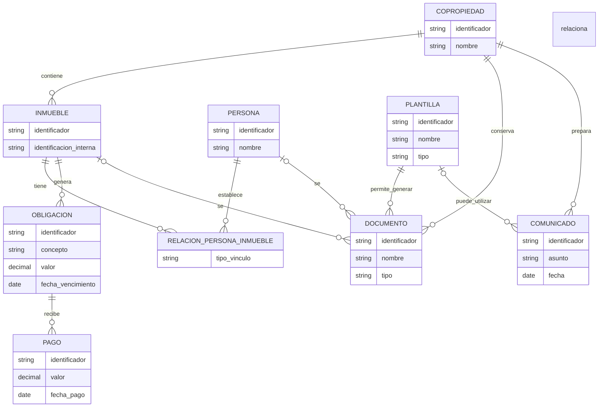

# Modelo del dominio — Kubo PH

**Estado:** Borrador inicial  
**Propósito:** Representar los conceptos principales de Kubo PH y sus relaciones, sin definir todavía la estructura física de la base de datos.

## Diagrama conceptual

## Notas sobre el modelo

- Una copropiedad puede contener varios inmuebles.
- Una persona puede estar relacionada con varios inmuebles y un inmueble puede estar relacionado con varias personas.
- La relación entre persona e inmueble representa el vínculo, por ejemplo, propietario o residente. Los tipos de vínculo y sus reglas se definirán posteriormente.
- Las obligaciones y los pagos se muestran de forma conceptual. Aún no se han definido las reglas para cuotas, descuentos, mora, acuerdos de pago ni conciliación.
- Los documentos pueden asociarse a una copropiedad y, cuando corresponda, a una persona o inmueble.
- Las plantillas permiten generar documentos y pueden utilizarse para preparar comunicados.
- El diagrama no representa todavía usuarios, roles, permisos, auditoría ni todos los módulos que podría incluir el MVP.

## Decisiones pendientes

- Definir los datos obligatorios y los identificadores de cada concepto.
- Definir cómo se registran los cambios de propietario y residente en el tiempo.
- Confirmar si una persona puede tener varios vínculos con el mismo inmueble.
- Precisar la relación entre obligaciones, pagos, soportes y extractos bancarios.
- Definir categorías, estados y permisos para documentos y comunicados.
- Revisar el modelo cuando se acuerde el alcance completo del MVP.

## Alcance del documento

Este es un modelo conceptual inicial. No constituye todavía el diseño de la base de datos ni una especificación definitiva de las reglas del negocio.
