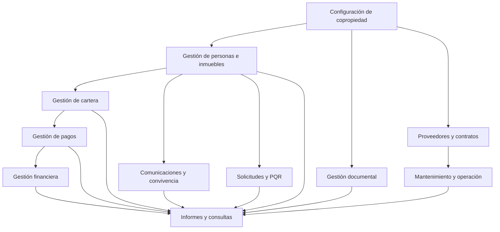

# Procesos del negocio — Kubo PH

**Versión:** 0.1  
**Estado:** Identificación inicial  
**Dominio:** Administración de propiedad horizontal

## 1. Propósito

Identificar los principales procesos que se desarrollan en la administración de una copropiedad, comprender sus actividades y establecer cómo Kubo PH puede apoyarlos mediante funcionalidades digitales.

Este documento servirá como referencia para completar los requisitos funcionales, las historias de usuario y las reglas del negocio.

Los procesos descritos son una propuesta inicial que deberá validarse con las actividades reales de administración.

## 2. Actores identificados

| Actor | Responsabilidad general |
|---|---|
| Administrador | Gestiona y supervisa los procesos de la copropiedad. |
| Auxiliar administrativo | Apoya las actividades administrativas y documentales. |
| Contabilidad | Gestiona y revisa información contable y financiera. |
| Consejo de administración | Participa en decisiones y seguimiento de la copropiedad. |
| Propietario | Persona titular de uno o varios inmuebles. |
| Residente | Persona que habita un inmueble. |
| Proveedor | Persona o empresa que presta servicios a la copropiedad. |

**Nota:** Los actores no implican que todos tendrán acceso directo a Kubo PH en el MVP.

## 3. Inventario de procesos

### 3.1. Administración de copropiedades

**Objetivo:** Mantener organizada la información general y administrativa de cada copropiedad.

Actividades:

- [ ] Registrar una nueva copropiedad.
- [ ] Actualizar información general.
- [ ] Organizar torres, bloques y sectores.
- [ ] Configurar inmuebles y nomenclaturas.
- [ ] Gestionar parámetros administrativos.
- [ ] Consultar información general.

### 3.2. Gestión de personas e inmuebles

**Objetivo:** Mantener actualizada la información de propietarios, residentes e inmuebles.

Actividades:

- [ ] Registrar personas.
- [ ] Registrar inmuebles.
- [ ] Asociar personas con inmuebles.
- [ ] Identificar propietarios y residentes.
- [ ] Actualizar información de contacto.
- [ ] Registrar cambios de propietario.
- [ ] Registrar cambios de residentes.
- [ ] Consultar el historial de relaciones.
- [ ] Identificar registros duplicados.

### 3.3. Gestión de cartera

**Objetivo:** Administrar las obligaciones económicas asociadas a los inmuebles.

Actividades:

- [ ] Configurar conceptos de cobro.
- [ ] Definir cuotas y periodos.
- [ ] Establecer fechas de vencimiento.
- [ ] Aplicar descuentos autorizados.
- [ ] Calcular obligaciones.
- [ ] Consultar saldos.
- [ ] Identificar obligaciones vencidas.
- [ ] Realizar seguimiento a la mora.
- [ ] Registrar acuerdos de pago.
- [ ] Generar estados de cuenta.
- [ ] Consultar reportes de cartera.

### 3.4. Gestión de pagos y recaudos

**Objetivo:** Registrar, identificar y aplicar los pagos realizados por los propietarios.

Actividades:

- [ ] Registrar pagos recibidos.
- [ ] Identificar el inmueble correspondiente.
- [ ] Asociar pagos con obligaciones.
- [ ] Registrar pagos parciales.
- [ ] Adjuntar comprobantes.
- [ ] Consultar historial de pagos.
- [ ] Importar movimientos bancarios.
- [ ] Identificar pagos pendientes de aplicación.
- [ ] Realizar conciliaciones.
- [ ] Generar reportes de recaudo.

### 3.5. Gestión financiera y presupuestal

**Objetivo:** Apoyar el seguimiento de los recursos y movimientos económicos de la copropiedad.

Actividades por analizar:

- [ ] Registrar ingresos.
- [ ] Registrar gastos.
- [ ] Organizar categorías de ingresos y egresos.
- [ ] Gestionar presupuestos.
- [ ] Consultar movimientos financieros.
- [ ] Comparar presupuesto y ejecución.
- [ ] Organizar soportes financieros.
- [ ] Generar informes financieros.

**Pendiente:** Definir el alcance de este proceso y su relación con cartera, pagos y contabilidad.

### 3.6. Gestión documental

**Objetivo:** Centralizar y organizar los documentos de la copropiedad.

Actividades:

- [ ] Cargar documentos.
- [ ] Clasificar archivos.
- [ ] Asociar documentos a personas, inmuebles o procesos.
- [ ] Consultar documentos.
- [ ] Descargar archivos.
- [ ] Organizar plantillas.
- [ ] Actualizar formatos.
- [ ] Generar documentos a partir de plantillas.
- [ ] Consultar versiones anteriores.

### 3.7. Comunicaciones y convivencia

**Objetivo:** Facilitar la elaboración, organización y seguimiento de comunicaciones administrativas.

Actividades:

- [ ] Elaborar comunicados.
- [ ] Gestionar plantillas.
- [ ] Elaborar llamados de atención.
- [ ] Asociar comunicaciones con inmuebles o personas.
- [ ] Registrar fechas y motivos.
- [ ] Consultar antecedentes.
- [ ] Organizar soportes.
- [ ] Consultar el historial de comunicaciones.

### 3.8. Gestión de solicitudes y PQR

**Objetivo:** Organizar las solicitudes, peticiones, quejas y reclamos recibidos por la administración.

Actividades:

- [ ] Registrar solicitudes.
- [ ] Identificar al solicitante.
- [ ] Clasificar solicitudes.
- [ ] Asignar responsables.
- [ ] Registrar fechas de recepción.
- [ ] Realizar seguimiento.
- [ ] Registrar respuestas.
- [ ] Adjuntar soportes.
- [ ] Consultar el historial.

### 3.9. Gestión de proveedores y contratos

**Objetivo:** Organizar la información relacionada con las empresas y personas que prestan servicios a la copropiedad.

Actividades:

- [ ] Registrar proveedores.
- [ ] Organizar información de contacto.
- [ ] Registrar contratos.
- [ ] Asociar documentos y soportes.
- [ ] Consultar vigencias.
- [ ] Realizar seguimiento a vencimientos.
- [ ] Consultar historial de servicios.

### 3.10. Mantenimiento y operación

**Objetivo:** Apoyar el seguimiento de las actividades de mantenimiento y conservación de la copropiedad.

Actividades:

- [ ] Registrar novedades.
- [ ] Registrar mantenimientos preventivos.
- [ ] Registrar mantenimientos correctivos.
- [ ] Identificar zonas comunes.
- [ ] Asignar responsables.
- [ ] Registrar fechas y estados.
- [ ] Adjuntar evidencias.
- [ ] Consultar historial de mantenimientos.

### 3.11. Gestión de reuniones y decisiones

**Objetivo:** Organizar la información relacionada con reuniones y decisiones administrativas.

Actividades:

- [ ] Registrar reuniones.
- [ ] Organizar convocatorias.
- [ ] Elaborar y almacenar actas.
- [ ] Registrar compromisos.
- [ ] Asignar responsables.
- [ ] Hacer seguimiento a compromisos.
- [ ] Consultar decisiones anteriores.

### 3.12. Informes y consultas administrativas

**Objetivo:** Facilitar el acceso a información consolidada para apoyar la gestión y toma de decisiones.

Actividades:

- [ ] Consultar información de personas e inmuebles.
- [ ] Consultar cartera.
- [ ] Consultar pagos y recaudos.
- [ ] Consultar movimientos financieros.
- [ ] Generar reportes administrativos.
- [ ] Exportar información.
- [ ] Consultar indicadores de gestión.

## 4. Relación entre procesos

El siguiente diagrama representa algunas dependencias generales entre procesos. No establece una secuencia obligatoria para todas las operaciones.

## 5. Consideraciones generales

- Los procesos pueden compartir información.
- La información debe estar asociada a la copropiedad correspondiente.
- Un proceso puede involucrar varios actores.
- Los documentos y soportes deben poder relacionarse con los procesos que los generan.
- Las reglas administrativas pueden variar entre copropiedades.
- Los cambios en las reglas deben poder gestionarse sin modificar innecesariamente toda la aplicación.

## 6. Aspectos pendientes de levantamiento

- [ ] Identificar los procesos que actualmente se realizan en Excel.
- [ ] Identificar los procesos que se realizan en Word y mediante documentos PDF.
- [ ] Identificar archivos y fuentes de información existentes.
- [ ] Documentar el procedimiento actual de liquidación de cuotas.
- [ ] Documentar el procedimiento de registro y aplicación de pagos.
- [ ] Identificar cómo se realiza la conciliación bancaria.
- [ ] Documentar el manejo de descuentos y acuerdos de pago.
- [ ] Identificar los documentos administrativos más utilizados.
- [ ] Identificar los procedimientos de solicitudes y PQR.
- [ ] Identificar los procesos que requieren aprobación del consejo.
- [ ] Determinar qué actividades necesitan historial y trazabilidad.
- [ ] Validar qué procesos deben incluirse en el MVP.

## 7. Resultado esperado

Este inventario servirá como punto de partida para elaborar los flujos detallados de cada proceso, identificar reglas del negocio y construir las historias de usuario definitivas.

La documentación deberá evolucionar conforme se validen los procedimientos reales de administración.

